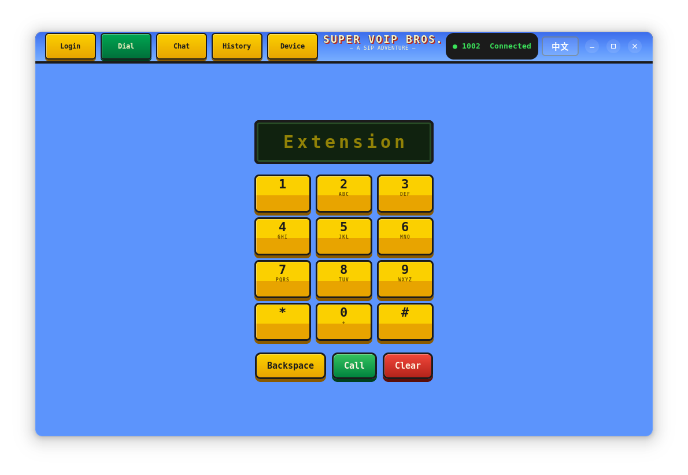

# Demo Voice Call

**English** | [简体中文](README.zh-CN.md)

A pixel-styled GTK 4 SIP client for the Quectel PI M2 development board, supporting voice calls and text chat over SIP MESSAGE.



## Features

- Register a SIP extension and view connection status.
- Make, answer, decline, and end voice calls.
- Use mute, DTMF, call duration, and RTP quality information during calls.
- Send and receive one-to-one text messages, including during calls.
- Review call history and inspect available audio devices.
- Switch the interface between Chinese and English.

Chat is online-only and does not retain history across restarts. SIP uses UDP without TLS, and messages are not end-to-end encrypted.

## Requirements

- Quectel PI M2 running a Debian/Ubuntu desktop image.
- A working microphone and speakers available through PipeWire or PulseAudio.
- A desktop D-Bus session; run the app from a desktop terminal rather than a bare SSH shell.
- An external SIP server with two extension accounts and UDP access for SIP and RTP.
- SIP MESSAGE routing enabled on the server for text chat.

The board runs the client only; the SIP server runs separately.

## Quick start

```bash
git clone https://github.com/lupin-santh/demo-voice-call.git
cd demo-voice-call
./scripts/deploy-board.sh
./scripts/run-app.sh
```

The deployment script installs dependencies, builds `voipd`, and installs it in your home directory. Run it as a normal desktop user, not with `sudo`.

In the login page, enter the SIP server address, extension account, and password. Closing the window or pressing `Ctrl+C` stops both the UI and `voipd`.

Useful commands:

```bash
./scripts/deploy-board.sh --keep-config  # Update without replacing the saved account
./scripts/board-check.sh                 # Check the board and audio environment
VOIP_LOG=1 ./scripts/run-app.sh           # Print logs to the terminal
```

## Project structure

```text
src/ui/       GTK 4 interface and stylesheet
src/voipd/    SIP, media, and D-Bus service
src/tools/    Audio and WAV analysis utilities
src/poc/      Protocol and audio prototypes
scripts/      Deployment, launch, and board-check scripts
assets/       App screenshot and ringtone
tests/        Simulation and live-server tests
```

`voipd` handles SIP and audio through liblinphone. The GTK UI communicates with it over D-Bus, and `scripts/run-app.sh` manages both processes.

## Tests

Run the isolated two-endpoint simulation after building `voipd`:

```bash
dbus-run-session -- python3 tests/test_chat.py --binary "$PWD/build/voipd"
```

`tests/test_live_chat.py` provides an optional test against a real SIP server. A manual audio check is still required to verify voice quality.

## License

See [LICENSE](LICENSE).

## Technical support and contributions

If you encounter any problems during use, please submit a technical inquiry on the [Quectel official forum](https://forums.quectel.com/c/quectel-pi/80). The Quectel technical support team will respond promptly.
