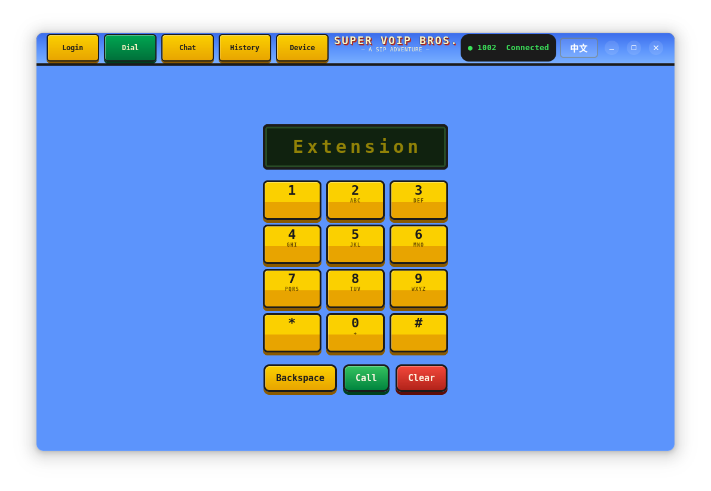

# Demo Voice Call

[English](README.md) | **简体中文**

一个适用于 Quectel PI M2 开发板的像素风 GTK 4 SIP 客户端，支持语音通话和基于 SIP MESSAGE 的文字聊天。



## 功能

- 注册 SIP 分机并查看连接状态。
- 拨打、接听、拒接和结束语音通话。
- 通话中使用静音、DTMF，查看通话时长和 RTP 质量信息。
- 收发一对一文字消息，通话期间也可使用。
- 查看通话记录和可用音频设备。
- 在中英文界面之间切换。

聊天仅支持在线使用，重启后不会保留历史记录。SIP 使用未启用 TLS 的 UDP，消息未进行端到端加密。

## 环境要求

- Quectel PI M2，运行 Debian/Ubuntu 桌面镜像。
- 麦克风和扬声器工作正常，并可被 PipeWire 或 PulseAudio 使用。
- 桌面 D-Bus 会话；请从桌面终端而非纯 SSH Shell 启动应用。
- 一台外部 SIP 服务器、两个分机账号，以及 SIP 和 RTP 所需的 UDP 网络连接。
- 文字聊天需要服务器启用 SIP MESSAGE 路由。

开发板仅运行客户端，SIP 服务器单独部署。

## 快速开始

```bash
git clone https://github.com/lupin-santh/demo-voice-call.git
cd demo-voice-call
./scripts/deploy-board.sh
./scripts/run-app.sh
```

部署脚本会安装依赖、构建 `voipd`，并将其安装到用户主目录。请以普通桌面用户身份运行，不要使用 `sudo`。

在登录页输入 SIP 服务器地址、分机账号和密码。关闭窗口或按 `Ctrl+C` 会同时停止 UI 和 `voipd`。

常用命令：

```bash
./scripts/deploy-board.sh --keep-config  # 更新部署，保留已保存的账号
./scripts/board-check.sh                 # 检查开发板和音频环境
VOIP_LOG=1 ./scripts/run-app.sh           # 将日志打印到终端
```

## 项目结构

```text
src/ui/       GTK 4 界面和样式
src/voipd/    SIP、媒体和 D-Bus 服务
src/tools/    音频与 WAV 分析工具
src/poc/      协议和音频原型
scripts/      部署、启动和开发板检查脚本
assets/       应用截图和铃声
tests/        模拟测试和真实服务器测试
```

`voipd` 通过 liblinphone 处理 SIP 和音频。GTK UI 通过 D-Bus 与其通信，`scripts/run-app.sh` 负责管理这两个进程。

## 测试

构建 `voipd` 后，运行隔离的双端点模拟测试：

```bash
dbus-run-session -- python3 tests/test_chat.py --binary "$PWD/build/voipd"
```

`tests/test_live_chat.py` 提供可选的真实 SIP 服务器测试。仍需手动进行音频检查以验证语音质量。

## 许可证

见 [LICENSE](LICENSE)。

## 技术支持与贡献

如在使用过程中遇到问题，欢迎在[移远官方论坛](https://forumschinese.quectel.com/c/quectel-pi/58)提交技术咨询，移远技术支持团队将及时为您解答。